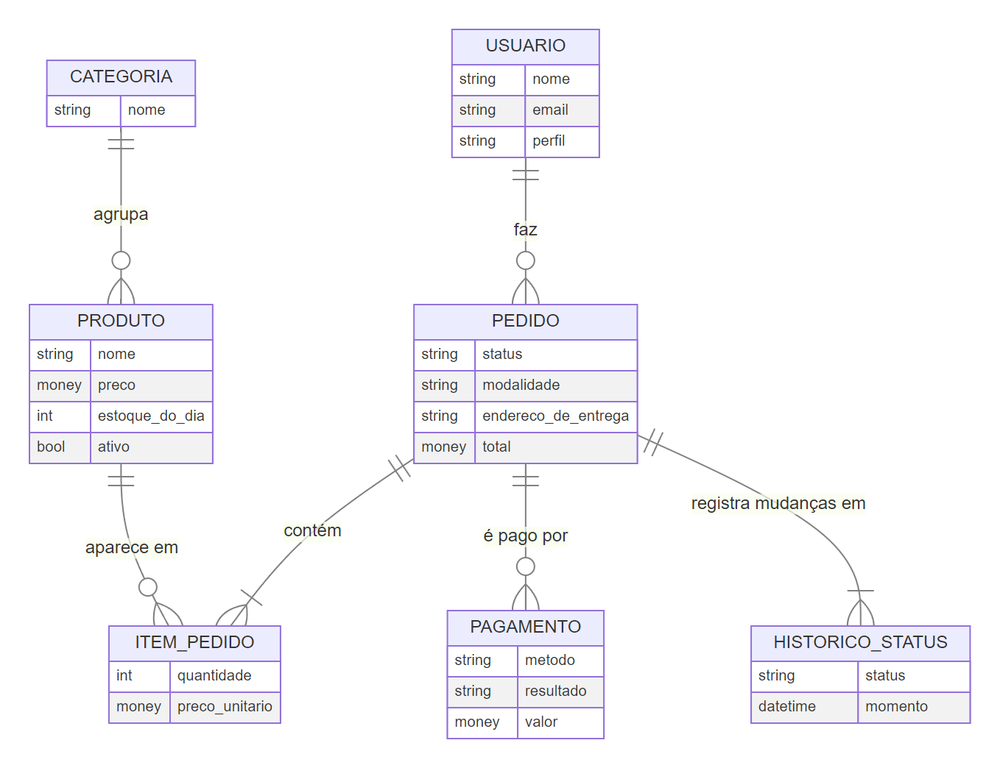
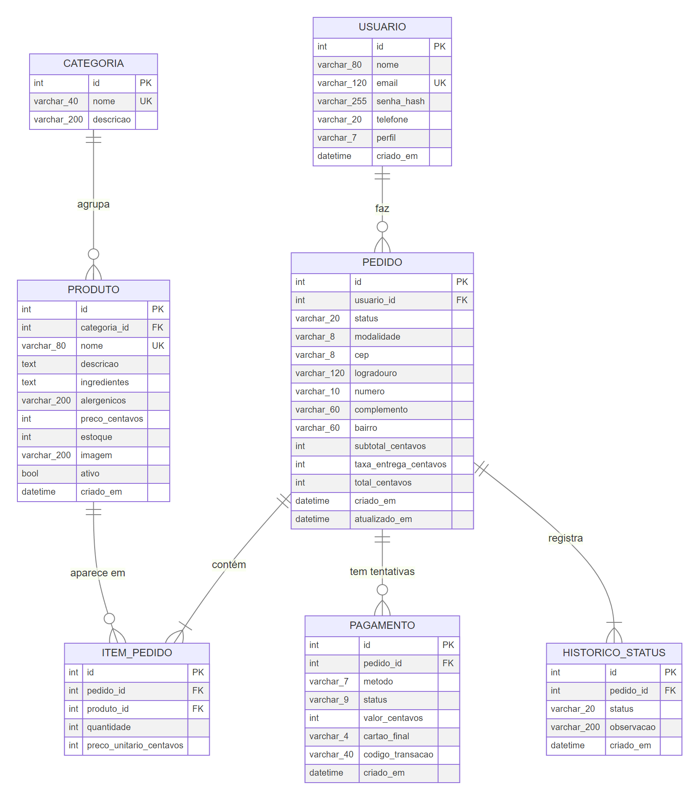

# Modelo de dados – LaCakes Cupcakes Gourmet

O banco foi derivado do diagrama de classes de persistência do planejamento
([docs/planejamento/uml.md](../planejamento/uml.md)). As três etapas do projeto de dados estão abaixo:
conceitual, lógico (normalizado) e físico.

## 1. Modelo conceitual

Entidades do negócio e como elas se relacionam, sem detalhes de implementação.



| Relacionamento | Cardinalidade | Leitura |
|---|---|---|
| Usuário – Pedido | 1 : N (0..*) | Um cliente faz zero ou mais pedidos; cada pedido é de um único cliente. |
| Categoria – Produto | 1 : N (0..*) | Uma categoria agrupa vários cupcakes; cada cupcake tem uma categoria. |
| Pedido – Item do pedido | 1 : N (1..*) | Todo pedido tem pelo menos um item. |
| Produto – Item do pedido | 1 : N (0..*) | Um cupcake pode aparecer em vários pedidos. É a tabela associativa do N : N entre Pedido e Produto. |
| Pedido – Pagamento | 1 : N (0..*) | Cada tentativa de pagamento fica registrada (aprovada, recusada ou estornada). |
| Pedido – Histórico de status | 1 : N (1..*) | Cada mudança de status gera um registro com data e hora. |

## 2. Modelo lógico (normalizado)



Esquema relacional (PK sublinhada na descrição, FK indicada com →):

- **usuario** (id PK, nome, email UNIQUE, senha_hash, telefone, perfil, criado_em)
- **categoria** (id PK, nome UNIQUE, descricao)
- **produto** (id PK, categoria_id → categoria.id, nome UNIQUE, descricao, ingredientes, alergenicos, preco_centavos, estoque, imagem, ativo, criado_em)
- **pedido** (id PK, usuario_id → usuario.id, status, modalidade, cep, logradouro, numero, complemento, bairro, subtotal_centavos, taxa_entrega_centavos, total_centavos, criado_em, atualizado_em)
- **item_pedido** (id PK, pedido_id → pedido.id, produto_id → produto.id, quantidade, preco_unitario_centavos; UNIQUE (pedido_id, produto_id))
- **pagamento** (id PK, pedido_id → pedido.id, metodo, status, valor_centavos, cartao_final, codigo_transacao, criado_em)
- **historico_status** (id PK, pedido_id → pedido.id, status, observacao, criado_em)

### Normalização

| Forma normal | Como o modelo atende |
|---|---|
| **1FN** | Todos os atributos são atômicos. Os itens do pedido ficam numa tabela própria (`item_pedido`) em vez de uma lista dentro do pedido; o endereço foi quebrado em `cep`, `logradouro`, `numero`, `complemento` e `bairro`. |
| **2FN** | Todas as tabelas têm chave primária simples (`id`), então não existe dependência parcial de parte da chave. Em `item_pedido`, a combinação (pedido, produto) é única, e `quantidade`/`preco_unitario` dependem dela inteira. |
| **3FN** | Não há atributos que dependam de outro atributo não chave: o nome da categoria fica só em `categoria` (o produto guarda apenas `categoria_id`); os dados do cliente ficam só em `usuario`. |

**Desnormalizações conscientes** (decisões de negócio, não erros):

- `item_pedido.preco_unitario_centavos` repete o preço do produto **de propósito**: é o preço do momento da compra (RN15). Se o preço do cupcake mudar, os pedidos antigos continuam certos.
- O endereço de entrega fica no **pedido**, e não numa tabela de endereços do cliente. Funciona como uma "foto" do endereço usado naquela compra e mantém o escopo enxuto (decisão D07).
- `subtotal`, `taxa` e `total` são gravados no pedido para não depender de recálculo; uma restrição `CHECK (total = subtotal + taxa)` garante a consistência.

## 3. Projeto físico

- SGBD padrão: **SQLite** (arquivo `instance/lacakes.db`), sem instalação.
- Para produção, basta definir a variável de ambiente `DATABASE_URL` para **PostgreSQL** ou **MySQL**. O código não muda, porque o acesso é feito pelo ORM (SQLAlchemy).
- Scripts DDL gerados a partir dos models:
  - [database/schema_sqlite.sql](../../database/schema_sqlite.sql)
  - [database/schema_postgresql.sql](../../database/schema_postgresql.sql) (com `COMMENT ON` em tabelas e colunas)
- Dicionário de dados: [database/dicionario-de-dados.md](../../database/dicionario-de-dados.md)

Escolhas do projeto físico:

| Escolha | Motivo |
|---|---|
| Dinheiro em **centavos (INTEGER)** | Evita erros de arredondamento de ponto flutuante e funciona igual em SQLite, PostgreSQL e MySQL. |
| Enumerações como **VARCHAR + CHECK** | Portável entre bancos (o tipo ENUM nativo só existe em alguns) e ainda impede valores inválidos. |
| **CHECK** de preço (R$ 1,00 a R$ 200,00), estoque (0 a 500) e quantidade (1 a 24) | As regras RN04 e RN14 ficam garantidas também no banco, não só na aplicação. |
| **Índices** em `usuario.email` (único), `pedido.usuario_id`, `pedido.status` e nas FKs | Aceleram login, "Meus pedidos", o filtro por status do admin e os joins. |
| Exclusão lógica de produto (`ativo = falso`) | Produtos que já estão em pedidos não podem sumir do histórico. |

Para recriar o banco do zero com os dados de exemplo:

```bash
python -m app.seed --recriar
```

Para gerar de novo os scripts SQL e o dicionário depois de mudar um model:

```bash
python scripts/gerar_docs_banco.py
```
