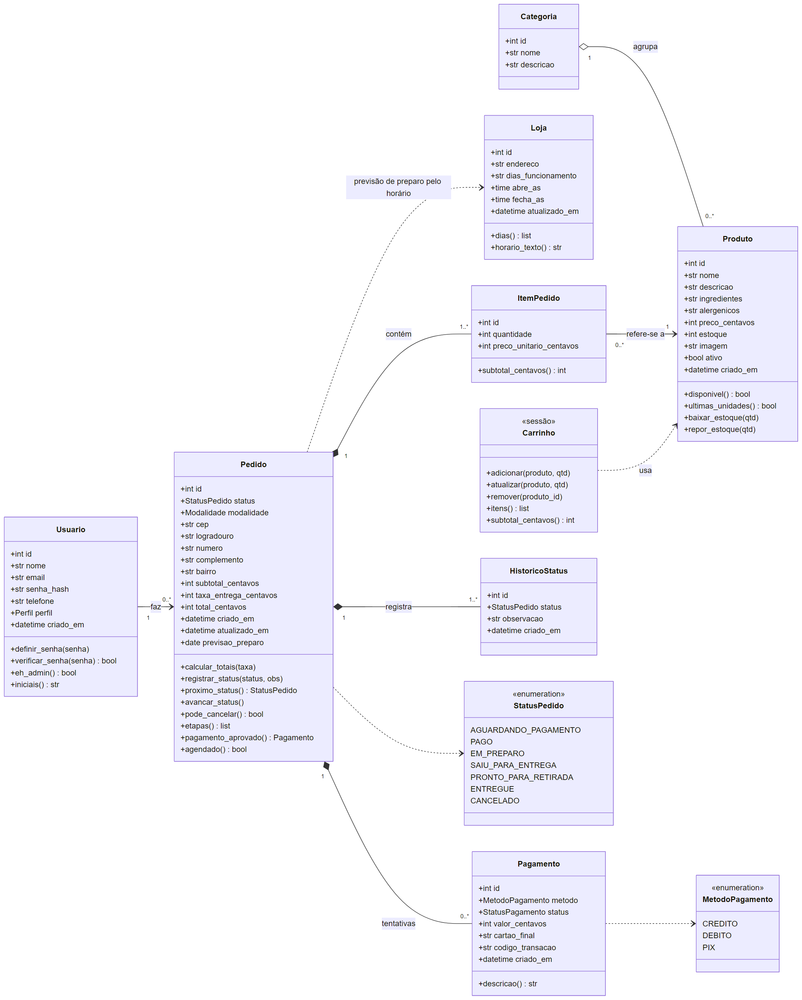
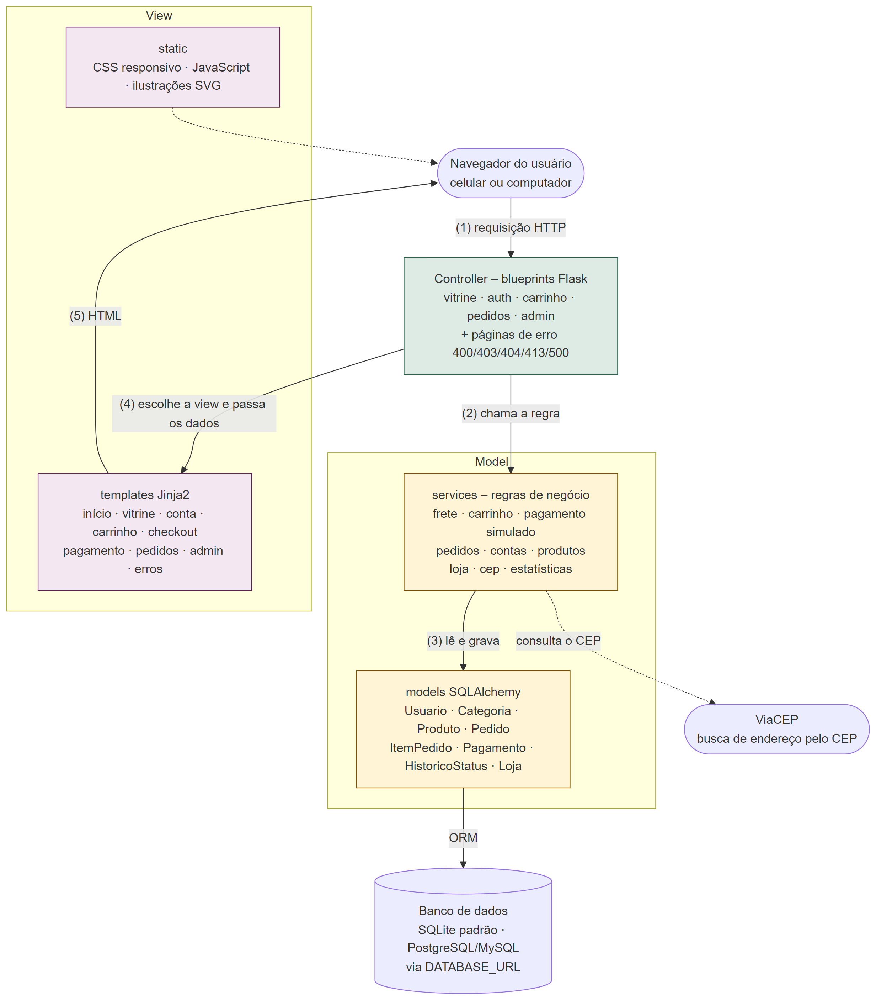
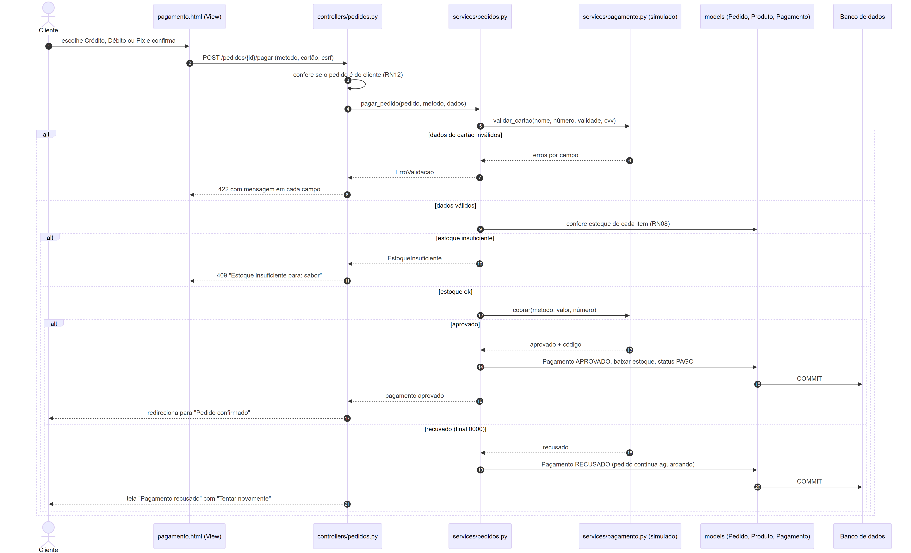

# Revisão do planejamento

Antes e durante a implementação, o planejamento ([docs/planejamento](../planejamento/README.md)) foi conferido item
por item, num ciclo de melhoria contínua. Este documento registra o que foi mantido, o que foi ajustado e por quê,
em quatro frentes: escopo, modelagem UML, interface (IHC) e dados.

## 1. Escopo

As **23 histórias de usuário** do backlog foram implementadas. Nenhuma foi cortada. Depois dos testes com usuários
(16/11/2026), entraram **5 histórias novas** (US24 a US28), também implementadas.

| Tema | Histórias | Situação |
|---|---|---|
| Vitrine virtual | US01, US02, US03, US04 | Implementadas |
| Conta do cliente | US05, US06, US07 | Implementadas |
| Carrinho, pedido e entrega | US08, US09, US10, US11, US12 | Implementadas |
| Pagamento | US13 (crédito e débito), US14 (Pix), US15 (recusa) | Implementadas, com pagamento simulado |
| Acompanhamento | US16, US17, US18 | Implementadas |
| Administração | US19, US20, US21, US22, US23 | Implementadas |
| Melhorias pedidas pelos testadores | US24 Dados da loja · US25 Aviso de loja fechada e previsão de preparo · US26 Estatísticas de vendas · US27 Tela inicial · US28 Endereço pelo CEP | Implementadas em 16/11/2026 ([testes.md](testes.md#34-correções-e-melhorias-feitas-após-os-testes)) |

Ajustes de escopo feitos durante a implementação:

| Ajuste | Motivo |
|---|---|
| Área de entrega definida pela faixa oficial de CEP de Jaú/SP (**17200-001 a 17229-999**), cidade da loja. | Regra RN07 ficou concreta e testável. A validação continua sem depender de serviço externo; o ViaCEP (US28) só ajuda a preencher rua e bairro. |
| Novas páginas de erro: **400** (formulário expirado/CSRF) e **413** (foto acima de 2 MB). | Erros que só apareceram ao implementar a segurança e o upload; o protótipo previa 403 e 404. |
| Aviso de **pedido mínimo já no carrinho** (antes do checkout). | Evita que o cliente só descubra a regra RN05 na última etapa. |
| Limite por sabor mostrado na página do produto ("máx. X"). | Deixa a regra RN04 visível antes do erro acontecer. |
| **Logout limpa o carrinho**. | US07: outra pessoa pode usar o mesmo aparelho. |
| Instalação com um comando (`iniciar.bat` / `iniciar.sh`). | Facilita a execução pelos testadores. |

## 2. Modelagem UML

### 2.1 Diagrama de classes (revisado)

| Mudança em relação ao planejamento | Motivo |
|---|---|
| Valores em dinheiro passaram de `decimal` para **`int` em centavos** (`preco_centavos`, `total_centavos`...). | Evita erros de arredondamento e funciona igual em SQLite, PostgreSQL e MySQL. |
| `MetodoPagamento` = **CREDITO, DEBITO, PIX**. | Separar crédito e débito permite mostrar e registrar a modalidade usada. |
| Novos métodos: `Pedido.registrar_status`, `Pedido.etapas`, `Pedido.pagamento_aprovado`, `Produto.ultimas_unidades`, `Usuario.iniciais`, `Pagamento.descricao`. | Regras que as telas precisavam (linha do tempo, selo "Últimas unidades", avatar com iniciais). |
| `Carrinho` aparece como classe **de sessão** (não persistida). | Deixa claro no diagrama que o carrinho não vai para o banco (decisão D06). |
| `ItemPedido` com restrição única (pedido, produto). | O mesmo sabor não se repete em duas linhas do mesmo pedido. |
| Enumerações `Perfil`, `Modalidade` e `StatusPagamento` mantidas, mas omitidas no diagrama revisado para dar espaço. | Continuam no código e no dicionário de dados. |

### 2.2 Arquitetura MVC

O planejamento previa MVC. Na implementação, a parte **Model** foi dividida em duas camadas: *models* (entidades
persistidas) e *services* (regras de negócio). Assim os controllers só tratam HTTP, e as regras podem ser testadas
sem navegador.

### 2.3 Casos de uso e diagramas de sequência

- Os 11 casos de uso foram mantidos. O UC07 (Realizar pagamento) passou a ter o passo "o cliente escolhe Crédito
  ou Débito".
- Os diagramas de sequência continuam válidos. Abaixo está a versão do pagamento com os **nomes reais dos módulos**
  e os códigos HTTP de cada caminho alternativo (422 para dados inválidos, 409 para estoque insuficiente).

## 3. Interface (IHC)

As 21 telas do protótipo (13 principais e 8 de erro) foram implementadas com a mesma paleta e a mesma estrutura.
As telas reais capturadas do sistema estão em [img/telas](img/telas). Ajustes feitos:

| Tela / elemento | Protótipo | Implementado | Motivo |
|---|---|---|---|
| Ícone de conta no topo | Emoji 👤 | Círculo branco com as **iniciais** do usuário, que abre o menu da conta (Meus pedidos, Administração, Sair). | O emoji ficava quase invisível sobre o Roxo Amora; o menu dá acesso ao "Sair" no celular. |
| Navegação | Barra inferior | Barra inferior no celular; **menu no topo** em telas largas (≥ 960 px), com vitrine em 4 colunas. | Responsividade (RNF01). |
| Pagamento | Abas Crédito/Débito/Pix | Abas como links: funcionam mesmo sem JavaScript. | Robustez e acessibilidade. |
| Campos de cartão e CEP | Texto livre | Máscaras simples (0000 0000 0000 0000, MM/AA, 00000-000). | Menos erros de digitação. |
| Carrinho | Botões − e + | − e + atualizam o total na hora; sem JavaScript aparece o botão "Atualizar". | Feedback imediato. |
| Admin – estoque do dia | Um campo por produto | Igual, com **"Salvar estoques do dia"** gravando tudo de uma vez; se algum valor for inválido, nada é salvo. | Evita salvar metade dos estoques por engano. |
| Admin – pedidos | Lista com botão avançar | Igual, com "Ver itens" mostrando sabores, endereço e telefone. | A confeitaria precisa disso para montar e entregar. |
| Telas de erro 403/404 | Telas separadas | Uma página de erro única, com código, ícone e mensagem próprios. | Mesmo visual para todos os erros (400, 403, 404, 413, 500). |
| Tela inicial (nova) | — | Boas-vindas, situação da loja, destaques, "Como funciona" e dados da loja; a vitrine passou para `/vitrine` e ganhou o item 🧁 na barra inferior. | Pedido dos testadores (US27). |
| Checkout – endereço | Campos digitados | Rua e bairro preenchidos pelo CEP, com mensagem logo abaixo do CEP. | Pedido dos testadores (US28). |
| Admin (novas abas) | Produtos e Pedidos | Produtos, Pedidos, **Vendas** e **Dados da loja**. | Pedido dos testadores (US24 e US26). |
| Acessibilidade | — | "Pular para o conteúdo", rótulos ligados aos campos, `aria-invalid` nos erros, `aria-current` na etapa atual e foco visível. | RNF05. |

## 4. Dados

O diagrama de classes de persistência foi transformado em projeto conceitual, lógico (normalizado até a 3FN) e
físico, com dicionário de dados: [modelo-de-dados.md](modelo-de-dados.md) e
[database/dicionario-de-dados.md](../../database/dicionario-de-dados.md).

| Ajuste | Motivo |
|---|---|
| Dinheiro em centavos (INTEGER). | Ver item 2.1. |
| Restrições CHECK para preço, estoque, quantidade e consistência do total do pedido. | As regras RN04, RN14 e RN15 ficam garantidas também pelo banco. |
| Enumerações como VARCHAR + CHECK. | Portável entre os bancos suportados. |
| Índices em e-mail, status e chaves estrangeiras. | Login, "Meus pedidos" e o filtro do admin mais rápidos. |
| Banco configurável por `DATABASE_URL` (SQLite, PostgreSQL ou MySQL). | RNF07, sem mudar o código. |
| Tabela nova `loja` e coluna `pedido.previsao_preparo` (US24 e US25). O `seed` atualiza bancos antigos sem apagar dados. | Horário de funcionamento editável e previsão de preparo gravada no pedido. |

## 5. Requisitos não funcionais

| RNF | Como foi atendido | Evidência |
|---|---|---|
| RNF01 Responsividade | CSS *mobile first*, com pontos de quebra em 700 px e 960 px. | [Vitrine no celular](img/telas/01-vitrine.png) e [no computador](img/telas/22-vitrine-computador.png) |
| RNF02 Senha com hash | `werkzeug.security` (scrypt); a senha nunca é gravada. | Teste `test_senha_guardada_como_hash` |
| RNF03 Desempenho | Páginas leves (sem frameworks de front-end), imagens SVG e índices no banco. | Vitrine carrega instantaneamente em rede local |
| RNF04 Mensagens de erro | Mensagens em português, embaixo do campo com problema. | [Cadastro com erros](img/telas/05-cadastro-com-erros.png) |
| RNF05 Acessibilidade | Contraste AA, `alt` nas imagens, rótulos, navegação por teclado. | Ver item 3 |
| RNF06 Sessão e formulários | CSRF em todos os formulários (Flask-WTF), cookie HttpOnly, rotas privadas exigem login. | Teste `test_csrf_ativo_fora_dos_testes` |
| RNF07 Portabilidade do banco | `DATABASE_URL`; scripts SQL para SQLite e PostgreSQL. | [database/](../../database) |
| RNF08 Manutenibilidade | MVC com camada de serviços; 171 testes automatizados, 95% de cobertura. | [testes.md](testes.md) |
| RNF09 Privacidade | Só os 4 últimos dígitos do cartão; CVV nunca é gravado. | Teste `test_credito_aprovado_baixa_estoque` |
| RNF10 Tratamento de erros | Páginas amigáveis para 400, 403, 404, 413 e 500. | Testes da classe `TestErros` |
