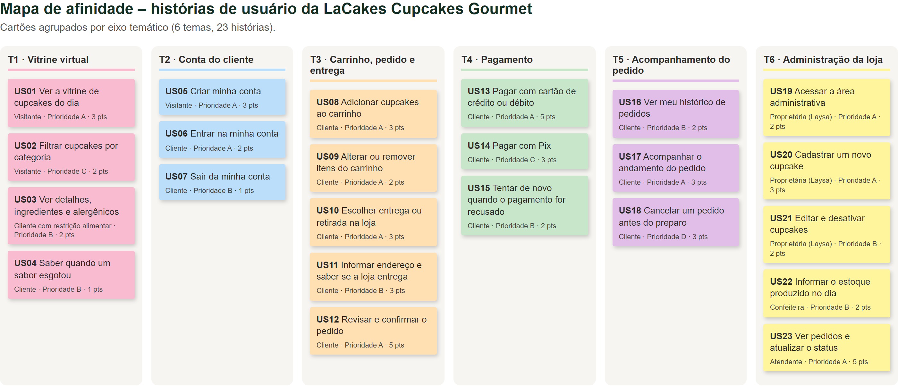

# Histórias de usuário

## Mapa de afinidade

## US01 – Ver a vitrine de cupcakes do dia

- **Tema:** Vitrine virtual
- **Requerente:** Visitante
- **Ação:** Como visitante, quero ver em uma única tela os cupcakes disponíveis hoje, com foto, nome e preço, para decidir rapidamente o que comprar sem precisar perguntar pelo WhatsApp.
- **Comentários:** É a porta de entrada do sistema. A Laysa (dona da loja) comentou que a maior parte das mensagens que recebe hoje é "quais sabores tem hoje?".
- **Prioridade:** A · **Pontos:** 3

**Critérios de aceitação**

1. Dado que existem cupcakes ativos, quando eu abro a página inicial, então vejo cards com foto, nome, preço e categoria de cada um.
2. Dado que um cupcake foi desativado pela loja, quando eu abro a vitrine, então ele não aparece.
3. Dado que não existe nenhum cupcake ativo, quando eu abro a vitrine, então vejo a mensagem "Nenhum cupcake disponível hoje. Volte mais tarde!".

**Regras de negócio:** RN03  
**RNF:** RNF01, RNF03, RNF05

## US02 – Filtrar cupcakes por categoria

- **Tema:** Vitrine virtual
- **Requerente:** Visitante
- **Ação:** Como visitante, quero filtrar a vitrine por categoria (Clássicos, Recheados, Zero açúcar e Datas especiais), para encontrar mais rápido o tipo de cupcake que procuro.
- **Comentários:** As categorias são cadastradas pela loja. O filtro deve funcionar bem no celular (botões grandes, que caibam na largura da tela).
- **Prioridade:** C · **Pontos:** 2

**Critérios de aceitação**

1. Dado que estou na vitrine, quando toco em uma categoria, então só vejo os cupcakes daquela categoria e o botão fica destacado.
2. Dado que filtrei uma categoria, quando toco em "Todos", então a vitrine volta a mostrar todos os cupcakes ativos.
3. Dado que a categoria escolhida não tem cupcakes ativos, quando aplico o filtro, então vejo a mensagem "Nenhum cupcake nesta categoria hoje".

**Regras de negócio:** RN03  
**RNF:** RNF01, RNF05

## US03 – Ver detalhes, ingredientes e alergênicos

- **Tema:** Vitrine virtual
- **Requerente:** Cliente com restrição alimentar
- **Ação:** Como cliente que tem alergia a amendoim, quero abrir a página de um cupcake e ver a descrição, os ingredientes e os alergênicos, para comprar com segurança.
- **Comentários:** Informação de alergênicos é um ponto sensível para a loja (responsabilidade com o consumidor). O campo é preenchido pela proprietária no cadastro do produto.
- **Prioridade:** B · **Pontos:** 2

**Critérios de aceitação**

1. Dado que estou na vitrine, quando toco em um cupcake, então abro a página de detalhes com foto grande, descrição, ingredientes, alergênicos, preço e estoque disponível.
2. Dado que o produto tem alergênicos cadastrados, quando abro os detalhes, então eles aparecem destacados com o título "Contém".
3. Dado que acesso o endereço de um produto que não existe, quando a página carrega, então vejo a tela de erro "Página não encontrada" com um botão para voltar à vitrine.

**Regras de negócio:** RN03, RN14  
**RNF:** RNF04, RNF05

## US04 – Saber quando um sabor esgotou

- **Tema:** Vitrine virtual
- **Requerente:** Cliente
- **Ação:** Como cliente, quero ver claramente quando um sabor esgotou no dia, para não perder tempo tentando comprar algo que a loja não tem mais.
- **Comentários:** A produção é feita em lotes diários. Hoje acontece de o cliente pedir pelo WhatsApp um sabor que já acabou e ficar frustrado.
- **Prioridade:** B · **Pontos:** 1

**Critérios de aceitação**

1. Dado que um cupcake está com estoque zero, quando vejo a vitrine, então o card mostra o selo "Esgotado" e o botão de adicionar fica desabilitado.
2. Dado que um cupcake está esgotado, quando tento adicioná-lo ao carrinho pelo endereço direto, então vejo a mensagem "Este cupcake esgotou hoje".
3. Dado que restam 5 unidades ou menos, quando vejo os detalhes, então aparece o aviso "Últimas unidades".

**Regras de negócio:** RN03, RN04  
**RNF:** RNF04

## US05 – Criar minha conta

- **Tema:** Conta do cliente
- **Requerente:** Visitante
- **Ação:** Como visitante, quero criar uma conta informando nome, e-mail, telefone e senha, para poder fazer pedidos e acompanhar minhas compras.
- **Comentários:** Cadastro curto, só com o necessário para a entrega e contato. O endereço é pedido na hora do pedido, não no cadastro, para não alongar o formulário.
- **Prioridade:** A · **Pontos:** 3

**Critérios de aceitação**

1. Dado que preencho todos os campos corretamente, quando envio o formulário, então minha conta é criada, já entro logado e vejo a mensagem "Conta criada com sucesso".
2. Dado que informo um e-mail que já está cadastrado, quando envio, então vejo a mensagem "Este e-mail já possui conta. Faça login." e os outros campos continuam preenchidos.
3. Dado que a senha tem menos de 8 caracteres ou não tem número, quando envio, então vejo o erro embaixo do campo senha explicando a regra.
4. Dado que a confirmação de senha é diferente da senha, quando envio, então vejo "As senhas não conferem".

**Regras de negócio:** RN01  
**RNF:** RNF02, RNF04, RNF06, RNF09

## US06 – Entrar na minha conta

- **Tema:** Conta do cliente
- **Requerente:** Cliente
- **Ação:** Como cliente cadastrado, quero entrar com e-mail e senha, para finalizar pedidos e ver meu histórico de compras.
- **Comentários:** Se o cliente estava montando o carrinho antes de entrar, o carrinho deve continuar lá depois do login.
- **Prioridade:** A · **Pontos:** 2

**Critérios de aceitação**

1. Dado que informo e-mail e senha corretos, quando clico em Entrar, então sou levado para a página de onde vim (ou para a vitrine) e vejo meu nome no menu.
2. Dado que informo e-mail ou senha errados, quando clico em Entrar, então vejo "E-mail ou senha inválidos" sem dizer qual dos dois está errado.
3. Dado que eu tinha itens no carrinho antes do login, quando entro, então os itens continuam no carrinho.

**Regras de negócio:** RN01, RN02  
**RNF:** RNF02, RNF04, RNF06

## US07 – Sair da minha conta

- **Tema:** Conta do cliente
- **Requerente:** Cliente
- **Ação:** Como cliente, quero sair da minha conta, para que outra pessoa que use o mesmo celular ou computador não veja meus pedidos.
- **Comentários:** Comum quando a família divide o mesmo computador.
- **Prioridade:** B · **Pontos:** 1

**Critérios de aceitação**

1. Dado que estou logado, quando toco em Sair, então minha sessão é encerrada, volto à vitrine e vejo "Você saiu da sua conta".
2. Dado que saí da conta, quando tento abrir "Meus pedidos", então sou levado à tela de login.

**Regras de negócio:** RN12  
**RNF:** RNF06

## US08 – Adicionar cupcakes ao carrinho

- **Tema:** Carrinho, pedido e entrega
- **Requerente:** Cliente
- **Ação:** Como cliente, quero escolher a quantidade de um cupcake e adicioná-lo ao carrinho, para montar meu pedido com vários sabores.
- **Comentários:** É comum comprar caixas de 4, 6 ou 12 unidades misturando sabores. Visitante também pode montar o carrinho; o login só é exigido para finalizar.
- **Prioridade:** A · **Pontos:** 3

**Critérios de aceitação**

1. Dado que o cupcake tem estoque, quando escolho a quantidade e toco em "Adicionar", então o item entra no carrinho e o contador do ícone do carrinho é atualizado.
2. Dado que o mesmo cupcake já está no carrinho, quando adiciono de novo, então a quantidade é somada em vez de criar outra linha.
3. Dado que a quantidade pedida passa do estoque disponível, quando adiciono, então vejo "Só temos X unidades deste sabor hoje" e o carrinho não muda.

**Regras de negócio:** RN03, RN04  
**RNF:** RNF01, RNF04

## US09 – Alterar ou remover itens do carrinho

- **Tema:** Carrinho, pedido e entrega
- **Requerente:** Cliente
- **Ação:** Como cliente, quero mudar a quantidade ou remover itens do carrinho e ver o total atualizado, para ajustar o pedido ao meu orçamento.
- **Comentários:** O resumo do carrinho deve mostrar subtotal, taxa de entrega (quando já escolhida) e total.
- **Prioridade:** A · **Pontos:** 2

**Critérios de aceitação**

1. Dado que tenho itens no carrinho, quando altero a quantidade de um item, então o subtotal do item e o total são recalculados.
2. Dado que tenho itens no carrinho, quando toco em "Remover", então o item sai do carrinho.
3. Dado que removi todos os itens, quando o carrinho fica vazio, então vejo "Seu carrinho está vazio" e um botão para voltar à vitrine.

**Regras de negócio:** RN04, RN05  
**RNF:** RNF01, RNF04

## US10 – Escolher entrega ou retirada na loja

- **Tema:** Carrinho, pedido e entrega
- **Requerente:** Cliente
- **Ação:** Como cliente, quero escolher se vou receber os cupcakes em casa ou retirar na loja e ver o valor do frete antes de pagar, para decidir o que sai mais em conta.
- **Comentários:** Retirada é muito usada por quem trabalha perto da loja. A taxa fixa foi definida pela proprietária.
- **Prioridade:** A · **Pontos:** 3

**Critérios de aceitação**

1. Dado que escolho "Retirar na loja", quando vejo o resumo, então a taxa de entrega é R$ 0,00 e aparece o endereço e horário da loja.
2. Dado que escolho "Entrega" e meu subtotal é menor que R$ 120,00, quando vejo o resumo, então a taxa de entrega é R$ 8,00.
3. Dado que escolho "Entrega" e meu subtotal é R$ 120,00 ou mais, quando vejo o resumo, então aparece "Entrega grátis".

**Regras de negócio:** RN06  
**RNF:** RNF04

## US11 – Informar endereço e saber se a loja entrega

- **Tema:** Carrinho, pedido e entrega
- **Requerente:** Cliente
- **Ação:** Como cliente, quero informar meu CEP e endereço e saber na hora se a loja entrega na minha região, para não fazer um pedido que não pode ser entregue.
- **Comentários:** A loja entrega só em Jaú/SP (CEPs de 17200-001 a 17229-999). Validação simples pela faixa de CEP; não há integração com serviço de CEP nesta versão.
- **Prioridade:** B · **Pontos:** 3

**Critérios de aceitação**

1. Dado que escolhi entrega, quando informo um CEP atendido e o endereço completo, então posso seguir para o pagamento.
2. Dado que informo um CEP fora da área, quando continuo, então vejo "Ainda não entregamos neste CEP. Você pode escolher Retirar na loja."
3. Dado que deixo rua, número ou bairro em branco, quando continuo, então vejo o erro no campo que faltou.

**Regras de negócio:** RN07  
**RNF:** RNF04

## US12 – Revisar e confirmar o pedido

- **Tema:** Carrinho, pedido e entrega
- **Requerente:** Cliente
- **Ação:** Como cliente, quero revisar itens, quantidades, endereço e valores antes de confirmar, para ter certeza de que o pedido está certo.
- **Comentários:** É o ponto onde o app anterior da loja errava: o cliente não via o resumo e os pedidos chegavam errados.
- **Prioridade:** A · **Pontos:** 5

**Critérios de aceitação**

1. Dado que estou logado e meu carrinho tem itens, quando vou para o checkout, então vejo a lista de itens, a modalidade, o endereço, o subtotal, a taxa e o total.
2. Dado que meu subtotal é menor que R$ 25,00, quando tento confirmar, então vejo "O pedido mínimo é de R$ 25,00".
3. Dado que não estou logado, quando toco em "Finalizar pedido", então sou levado ao login e depois volto ao checkout.
4. Dado que tudo está correto, quando confirmo, então o pedido é criado com status "Aguardando pagamento" e vou para a tela de pagamento.

**Regras de negócio:** RN02, RN05, RN06, RN15  
**RNF:** RNF04, RNF06

## US13 – Pagar com cartão de crédito ou débito

- **Tema:** Pagamento
- **Requerente:** Cliente
- **Ação:** Como cliente, quero pagar meu pedido com cartão de crédito ou de débito sem sair do site, para concluir a compra de forma rápida e do jeito que eu preferir.
- **Comentários:** Muitos clientes preferem o débito para não usar o limite do cartão. Nesta versão o pagamento é simulado (não há gateway real). O sistema nunca guarda o número completo nem o CVV, só a modalidade e os 4 últimos dígitos.
- **Prioridade:** A · **Pontos:** 5

**Critérios de aceitação**

1. Dado que escolho Crédito e informo um cartão válido, quando confirmo o pagamento, então o pedido passa para "Pago", o estoque é baixado e vejo a tela "Pedido confirmado" com o número do pedido.
2. Dado que escolho Débito e informo um cartão válido, quando confirmo o pagamento, então o pedido passa para "Pago" e o resumo mostra "Pago no débito".
3. Dado que informo um cartão com número, validade ou CVV inválidos, quando confirmo, então vejo o erro no campo correspondente.
4. Dado que um item esgotou enquanto eu pagava, quando confirmo, então vejo "Estoque insuficiente para: [sabor]" e o pagamento não é feito.

**Regras de negócio:** RN08, RN09, RN10  
**RNF:** RNF06, RNF09

## US14 – Pagar com Pix

- **Tema:** Pagamento
- **Requerente:** Cliente
- **Ação:** Como cliente, quero pagar com Pix copiando um código, para não precisar digitar dados de cartão.
- **Comentários:** Pix é o meio mais usado pelos clientes da loja hoje. Na simulação, o código é gerado e o cliente clica em "Já paguei" para confirmar.
- **Prioridade:** C · **Pontos:** 3

**Critérios de aceitação**

1. Dado que escolho Pix, quando avanço, então vejo o valor e um código "copia e cola" com um botão para copiar.
2. Dado que copiei o código, quando toco em "Já paguei", então o pedido passa para "Pago" e vejo a tela "Pedido confirmado".

**Regras de negócio:** RN08, RN09, RN10  
**RNF:** RNF01, RNF04

## US15 – Tentar de novo quando o pagamento for recusado

- **Tema:** Pagamento
- **Requerente:** Cliente
- **Ação:** Como cliente, quero receber uma mensagem clara quando meu pagamento for recusado e poder tentar de novo ou trocar a forma de pagamento, para não perder o pedido.
- **Comentários:** O pedido continua "Aguardando pagamento" e cada tentativa fica registrada.
- **Prioridade:** B · **Pontos:** 2

**Critérios de aceitação**

1. Dado que meu cartão foi recusado, quando a resposta chega, então vejo a tela "Pagamento recusado" explicando que nenhum valor foi cobrado.
2. Dado que estou na tela de recusa, quando toco em "Tentar novamente", então volto ao pagamento com o mesmo pedido e posso escolher crédito, débito ou Pix.
3. Dado que tive uma recusa, quando consulto "Meus pedidos", então o pedido aparece como "Aguardando pagamento".

**Regras de negócio:** RN09, RN10  
**RNF:** RNF04

## US16 – Ver meu histórico de pedidos

- **Tema:** Acompanhamento do pedido
- **Requerente:** Cliente
- **Ação:** Como cliente, quero ver a lista dos meus pedidos com data, valor e status, para lembrar o que comprei e acompanhar o que está em andamento.
- **Comentários:** Lista do mais recente para o mais antigo.
- **Prioridade:** B · **Pontos:** 2

**Critérios de aceitação**

1. Dado que tenho pedidos, quando abro "Meus pedidos", então vejo número, data, total e status de cada um, do mais recente para o mais antigo.
2. Dado que não tenho pedidos, quando abro "Meus pedidos", então vejo "Você ainda não fez pedidos" e um botão para a vitrine.
3. Dado que tento abrir o pedido de outro cliente pelo endereço, quando a página carrega, então vejo a tela "Acesso negado".

**Regras de negócio:** RN12  
**RNF:** RNF01, RNF06

## US17 – Acompanhar o andamento do pedido

- **Tema:** Acompanhamento do pedido
- **Requerente:** Cliente
- **Ação:** Como cliente, quero ver em que etapa meu pedido está (pago, em preparo, saiu para entrega, entregue), para saber quando os cupcakes vão chegar.
- **Comentários:** Substitui as mensagens "já saiu?" no WhatsApp. Mostrar as etapas em linha do tempo, com data e hora de cada mudança.
- **Prioridade:** A · **Pontos:** 3

**Critérios de aceitação**

1. Dado que tenho um pedido, quando abro os detalhes dele, então vejo uma linha do tempo com as etapas e a etapa atual destacada.
2. Dado que a loja mudou o status, quando atualizo a página, então vejo a nova etapa com data e hora.
3. Dado que o pedido é para retirada, quando ele fica pronto, então a etapa mostrada é "Pronto para retirada" com o endereço da loja.

**Regras de negócio:** RN10, RN12  
**RNF:** RNF01, RNF05

## US18 – Cancelar um pedido antes do preparo

- **Tema:** Acompanhamento do pedido
- **Requerente:** Cliente
- **Ação:** Como cliente, quero cancelar um pedido que ainda não entrou em preparo, para corrigir um engano sem precisar ligar para a loja.
- **Comentários:** Depois que a confeiteira começa a montar a caixa, não dá mais para cancelar pelo sistema.
- **Prioridade:** D · **Pontos:** 3

**Critérios de aceitação**

1. Dado que meu pedido está "Aguardando pagamento" ou "Pago", quando toco em "Cancelar pedido" e confirmo, então o status vira "Cancelado".
2. Dado que o pedido estava pago, quando cancelo, então o estoque dos itens volta e aparece "Pagamento estornado".
3. Dado que o pedido já está "Em preparo" ou depois, quando abro os detalhes, então o botão de cancelar não aparece.

**Regras de negócio:** RN10, RN11  
**RNF:** RNF04

## US19 – Acessar a área administrativa

- **Tema:** Administração da loja
- **Requerente:** Proprietária (Laysa)
- **Ação:** Como proprietária da loja, quero uma área administrativa protegida por login, para que só a minha equipe consiga mexer em produtos e pedidos.
- **Comentários:** O primeiro administrador é criado por script na instalação. Clientes comuns nunca veem o menu de administração.
- **Prioridade:** A · **Pontos:** 2

**Critérios de aceitação**

1. Dado que entro com uma conta de administrador, quando o login é feito, então vejo o menu "Administração".
2. Dado que sou cliente comum, quando tento abrir um endereço /admin, então vejo a tela "Acesso negado".
3. Dado que não estou logado, quando tento abrir /admin, então sou levado para o login.

**Regras de negócio:** RN13  
**RNF:** RNF02, RNF06

## US20 – Cadastrar um novo cupcake

- **Tema:** Administração da loja
- **Requerente:** Proprietária (Laysa)
- **Ação:** Como proprietária, quero cadastrar um cupcake com nome, categoria, descrição, ingredientes, alergênicos, preço, foto e estoque do dia, para que ele apareça na vitrine.
- **Comentários:** A loja lança sabores sazonais com frequência (Páscoa, festa junina, Natal).
- **Prioridade:** A · **Pontos:** 3

**Critérios de aceitação**

1. Dado que preencho os campos obrigatórios corretamente, quando salvo, então o cupcake aparece na lista de produtos e na vitrine (se estiver ativo).
2. Dado que deixo o nome em branco ou uso um nome já existente, quando salvo, então vejo o erro no campo nome.
3. Dado que informo preço fora da faixa de R$ 1,00 a R$ 200,00, quando salvo, então vejo o erro no campo preço.
4. Dado que não envio foto, quando salvo, então o produto usa a imagem padrão da loja.

**Regras de negócio:** RN13, RN14  
**RNF:** RNF04, RNF05

## US21 – Editar e desativar cupcakes

- **Tema:** Administração da loja
- **Requerente:** Proprietária (Laysa)
- **Ação:** Como proprietária, quero editar dados e preço de um cupcake ou desativá-lo, para tirar da vitrine um sabor fora de época sem perder o histórico de vendas.
- **Comentários:** Desativar em vez de excluir, porque o produto pode estar em pedidos antigos.
- **Prioridade:** B · **Pontos:** 2

**Critérios de aceitação**

1. Dado que altero o preço de um cupcake, quando salvo, então a vitrine mostra o novo preço e os pedidos antigos continuam com o preço antigo.
2. Dado que desativo um cupcake, quando salvo, então ele some da vitrine mas continua na lista do admin marcado como "Inativo".
3. Dado que reativo um cupcake, quando salvo, então ele volta para a vitrine.

**Regras de negócio:** RN13, RN14, RN15  
**RNF:** RNF04

## US22 – Informar o estoque produzido no dia

- **Tema:** Administração da loja
- **Requerente:** Confeiteira
- **Ação:** Como confeiteira, quero informar rapidamente quantas unidades de cada sabor foram produzidas hoje, para que a vitrine mostre só o que realmente existe.
- **Comentários:** Feito toda manhã, logo após a produção. Precisa ser rápido: um campo de quantidade por produto na própria lista.
- **Prioridade:** B · **Pontos:** 2

**Critérios de aceitação**

1. Dado que estou na lista de produtos do admin, quando altero o estoque de um sabor e salvo, então a vitrine passa a usar a nova quantidade.
2. Dado que informo estoque negativo ou acima de 500, quando salvo, então vejo uma mensagem de erro.
3. Dado que coloco estoque zero, quando salvo, então o sabor aparece como "Esgotado" na vitrine.

**Regras de negócio:** RN03, RN13, RN14  
**RNF:** RNF01, RNF04

## US23 – Ver pedidos e atualizar o status

- **Tema:** Administração da loja
- **Requerente:** Atendente
- **Ação:** Como atendente, quero ver os pedidos recebidos, filtrar por status e avançar a etapa de cada um, para organizar a produção e manter o cliente informado.
- **Comentários:** Mostrar primeiro os pedidos pagos (que precisam ser preparados). O avanço é sempre para a próxima etapa válida.
- **Prioridade:** A · **Pontos:** 5

**Critérios de aceitação**

1. Dado que existem pedidos, quando abro "Pedidos" no admin, então vejo número, cliente, modalidade, total, status e data.
2. Dado que um pedido está "Pago", quando toco em "Avançar status", então ele passa para "Em preparo" e o cliente vê a mudança.
3. Dado que um pedido está "Aguardando pagamento", quando tento avançar, então vejo "Este pedido ainda não foi pago" e o status não muda.
4. Dado que filtro por um status, quando aplico, então só vejo os pedidos naquele status.

**Regras de negócio:** RN10, RN13  
**RNF:** RNF01, RNF06
