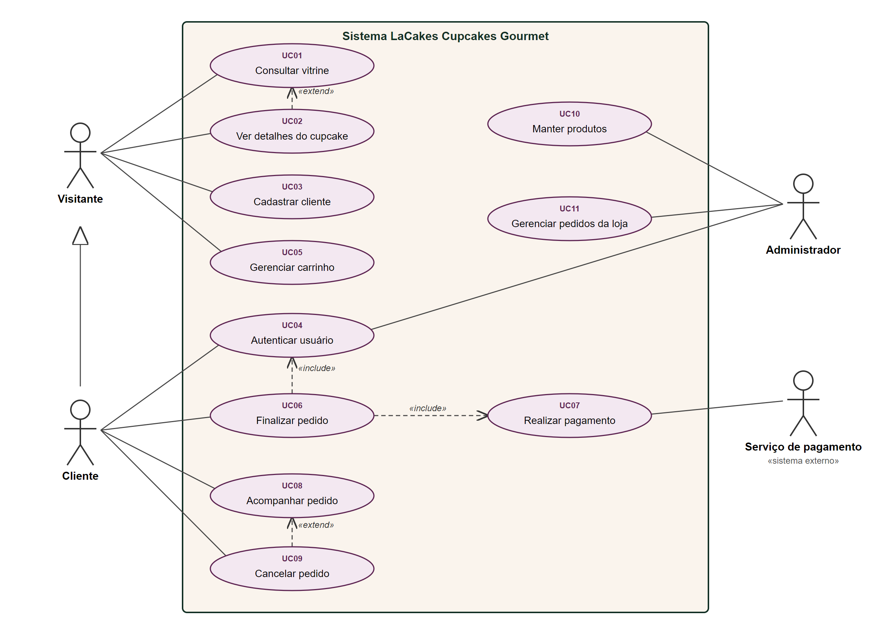
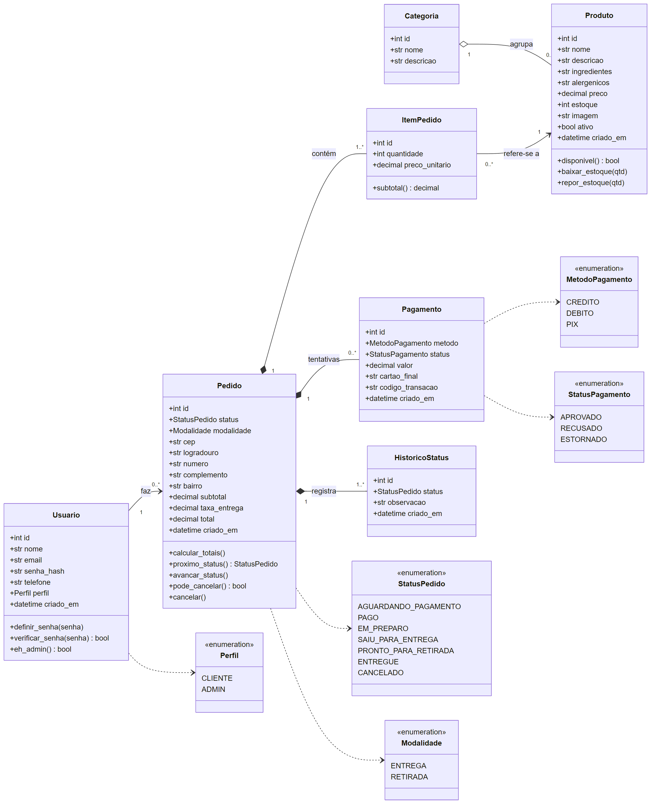
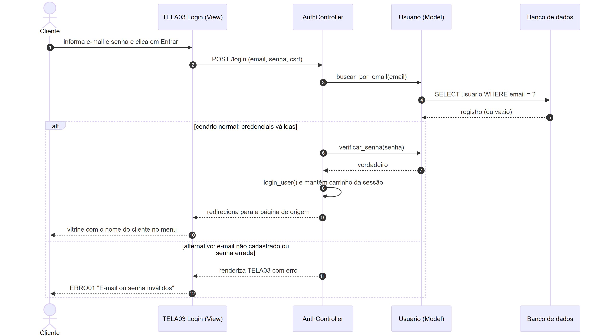
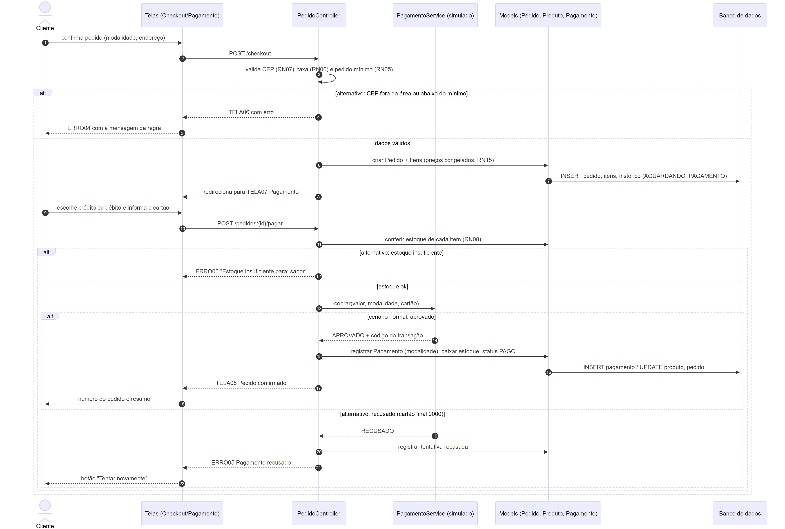
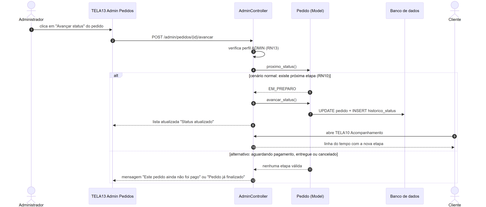
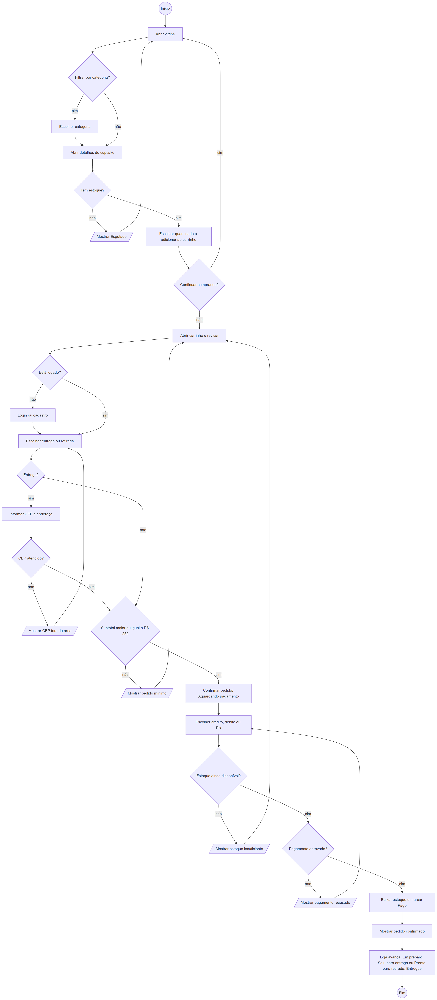

# Casos de uso e diagramas UML

## Diagrama de caso de uso geral

## UC01 – Consultar vitrine

- **Atores:** Visitante, Cliente
- **Descrição:** Exibir os cupcakes ativos do dia, com opção de filtro por categoria.
- **Pré-condições:** Nenhuma.
- **Pós-condições:** O usuário visualizou os produtos disponíveis.
- **Histórias:** US01, US02, US04

**Curso básico de ação**

1. O caso de uso começa quando o usuário acessa a página inicial.
2. O sistema busca os produtos ativos e suas categorias (RN03).
3. O sistema exibe a TELA01 – Vitrine com os cards dos cupcakes; produtos sem estoque mostram o selo "Esgotado". <Alternativo A1>
4. O usuário escolhe uma categoria. <Alternativo A2>
5. O sistema exibe apenas os produtos da categoria escolhida.
6. O caso de uso termina quando o usuário abre um produto (UC02) ou sai da página.

**Curso alternativo A1 – Nenhum produto ativo**

- A1.3: O sistema exibe "Nenhum cupcake disponível hoje. Volte mais tarde!".
- A1.4: O caso de uso termina.

**Curso alternativo A2 – Usuário não filtra**

- A2.4: O usuário continua vendo todos os produtos.
- A2.5: O caso de uso continua no passo 6.

## UC02 – Ver detalhes do cupcake

- **Atores:** Visitante, Cliente
- **Descrição:** Mostrar informações completas de um cupcake, incluindo ingredientes e alergênicos.
- **Pré-condições:** O produto foi selecionado na vitrine.
- **Pós-condições:** O usuário conhece os detalhes do produto e pode adicioná-lo ao carrinho.
- **Histórias:** US03, US04

**Curso básico de ação**

1. O usuário toca em um cupcake na TELA01.
2. O sistema busca o produto pelo identificador. <Alternativo A1>
3. O sistema exibe a TELA02 – Detalhes, com descrição, ingredientes, alergênicos, preço e estoque (RN03).
4. O usuário pode adicionar o produto ao carrinho (UC05).

**Curso alternativo A1 – Produto inexistente ou inativo**

- A1.2: O sistema não encontra o produto ativo.
- A1.3: O sistema exibe a ERRO07 – Página não encontrada, com botão para a vitrine.
- A1.4: O caso de uso termina.

## UC03 – Cadastrar cliente

- **Atores:** Visitante
- **Descrição:** Criar a conta de um novo cliente.
- **Pré-condições:** O visitante não está autenticado.
- **Pós-condições:** Conta criada e cliente autenticado.
- **Histórias:** US05

**Curso básico de ação**

1. O visitante toca em "Criar conta".
2. O sistema exibe a TELA04 – Cadastro.
3. O visitante informa nome, e-mail, telefone, senha e confirmação de senha.
4. O sistema valida os campos e a regra RN01. <Alternativo A1> <Alternativo A2>
5. O sistema grava o usuário com a senha em hash (RNF02) e perfil Cliente.
6. O sistema autentica o cliente e exibe a vitrine com a mensagem "Conta criada com sucesso".

**Curso alternativo A1 – E-mail já cadastrado**

- A1.4: O sistema identifica que o e-mail já existe.
- A1.5: O sistema exibe a ERRO02 com a mensagem "Este e-mail já possui conta. Faça login." mantendo os outros campos.
- A1.6: Volta ao passo 3.

**Curso alternativo A2 – Dados inválidos**

- A2.4: O sistema identifica campos vazios, senha fraca ou senhas diferentes.
- A2.5: O sistema exibe a ERRO02 com a mensagem embaixo de cada campo com problema.
- A2.6: Volta ao passo 3.

## UC04 – Autenticar usuário

- **Atores:** Cliente, Administrador
- **Descrição:** Permitir a entrada (login) e a saída (logout) de usuários cadastrados.
- **Pré-condições:** O usuário possui conta.
- **Pós-condições:** Sessão iniciada (ou encerrada no logout).
- **Histórias:** US06, US07, US19

**Curso básico de ação**

1. O usuário toca em "Entrar" ou é redirecionado ao tentar acessar uma área protegida.
2. O sistema exibe a TELA03 – Login.
3. O usuário informa e-mail e senha.
4. O sistema confere as credenciais. <Alternativo A1>
5. O sistema inicia a sessão, mantém o carrinho atual e leva o usuário para a página de origem (ou para a vitrine).
6. Se o usuário for Administrador, o sistema mostra o menu "Administração" (RN13).

**Curso alternativo A1 – Credenciais inválidas**

- A1.4: O sistema não encontra o e-mail ou a senha não confere.
- A1.5: O sistema exibe a ERRO01 com "E-mail ou senha inválidos".
- A1.6: Volta ao passo 3.

**Curso alternativo A2 – Logout**

- A2.1: O usuário autenticado toca em "Sair".
- A2.2: O sistema encerra a sessão e exibe a vitrine com "Você saiu da sua conta".

## UC05 – Gerenciar carrinho

- **Atores:** Visitante, Cliente
- **Descrição:** Adicionar, alterar quantidade e remover cupcakes do carrinho.
- **Pré-condições:** Existe ao menos um produto ativo.
- **Pós-condições:** Carrinho atualizado na sessão com totais recalculados.
- **Histórias:** US08, US09

**Curso básico de ação**

1. O usuário escolhe a quantidade na TELA02 e toca em "Adicionar ao carrinho".
2. O sistema verifica se o produto está ativo e se há estoque (RN03, RN04). <Alternativo A1>
3. O sistema adiciona o item (ou soma a quantidade se já existir) e atualiza o contador.
4. O usuário abre a TELA05 – Carrinho.
5. O sistema exibe itens, subtotal por item e subtotal geral. <Alternativo A2>
6. O usuário altera quantidades ou remove itens.
7. O sistema recalcula os valores.
8. O caso de uso termina quando o usuário toca em "Finalizar pedido" (UC06) ou volta à vitrine.

**Curso alternativo A1 – Estoque insuficiente ou esgotado**

- A1.2: O sistema verifica que não há estoque suficiente.
- A1.3: O sistema exibe a ERRO06 com "Só temos X unidades deste sabor hoje".
- A1.4: O carrinho não é alterado e volta ao passo 1.

**Curso alternativo A2 – Carrinho vazio**

- A2.5: O sistema exibe a ERRO03 – "Seu carrinho está vazio" com botão para a vitrine.
- A2.6: O caso de uso termina.

## UC06 – Finalizar pedido

- **Atores:** Cliente
- **Descrição:** Transformar o carrinho em um pedido, definindo modalidade de entrega e endereço.
- **Pré-condições:** Carrinho com pelo menos um item.
- **Pós-condições:** Pedido criado com status "Aguardando pagamento" e preços congelados.
- **Histórias:** US10, US11, US12

**Curso básico de ação**

1. O cliente toca em "Finalizar pedido" na TELA05.
2. O sistema verifica se o cliente está autenticado (RN02). <Alternativo A1>
3. O sistema exibe a TELA06 – Checkout com o resumo dos itens.
4. O cliente escolhe "Entrega" ou "Retirar na loja".
5. Se for entrega, o cliente informa CEP, rua, número, complemento e bairro.
6. O sistema valida o CEP pela RN07 e calcula a taxa de entrega pela RN06. <Alternativo A2>
7. O sistema exibe subtotal, taxa e total.
8. O cliente confirma o pedido.
9. O sistema valida o pedido mínimo (RN05). <Alternativo A3>
10. O sistema cria o pedido, grava os itens com o preço atual (RN15) e registra o status "Aguardando pagamento" (RN10).
11. O sistema inclui o caso de uso UC07 – Realizar pagamento.

**Curso alternativo A1 – Cliente não autenticado**

- A1.2: O sistema redireciona para a TELA03 – Login (UC04).
- A1.3: Após o login, o caso de uso volta ao passo 3.

**Curso alternativo A2 – CEP fora da área**

- A2.6: O sistema exibe a ERRO04 com "Ainda não entregamos neste CEP. Você pode escolher Retirar na loja."
- A2.7: Volta ao passo 4.

**Curso alternativo A3 – Abaixo do pedido mínimo**

- A3.9: O sistema exibe a ERRO04 com "O pedido mínimo é de R$ 25,00".
- A3.10: O cliente volta ao carrinho (UC05).

## UC07 – Realizar pagamento

- **Atores:** Cliente, Serviço de pagamento (simulado)
- **Descrição:** Pagar um pedido com cartão de crédito, cartão de débito ou Pix (simulados).
- **Pré-condições:** Pedido do cliente com status "Aguardando pagamento".
- **Pós-condições:** Pedido "Pago", pagamento aprovado registrado e estoque baixado.
- **Histórias:** US13, US14, US15

**Curso básico de ação**

1. O sistema exibe a TELA07 – Pagamento com o total do pedido.
2. O cliente escolhe "Crédito" ou "Débito". <Alternativo A1>
3. O cliente informa nome impresso, número, validade e CVV.
4. O sistema valida os dados do cartão (RN09). <Alternativo A2>
5. O sistema confere novamente o estoque de cada item (RN08). <Alternativo A3>
6. O sistema envia a cobrança ao serviço de pagamento simulado. <Alternativo A4>
7. O sistema registra o pagamento aprovado com a modalidade (crédito ou débito), guardando só os 4 últimos dígitos (RNF09).
8. O sistema baixa o estoque e muda o pedido para "Pago" (RN08, RN10).
9. O sistema exibe a TELA08 – Pedido confirmado.

**Curso alternativo A1 – Pagamento com Pix**

- A1.2: O cliente escolhe Pix.
- A1.3: O sistema exibe o código "copia e cola" e o botão "Já paguei".
- A1.4: O cliente toca em "Já paguei".
- A1.5: O caso de uso continua no passo 5.

**Curso alternativo A2 – Dados do cartão inválidos**

- A2.4: O sistema mostra o erro em cada campo inválido.
- A2.5: Volta ao passo 3.

**Curso alternativo A3 – Estoque insuficiente**

- A3.5: O sistema identifica item sem estoque suficiente.
- A3.6: O sistema exibe a ERRO06 informando o sabor, e nada é cobrado.
- A3.7: O cliente volta ao carrinho para ajustar (UC05).

**Curso alternativo A4 – Pagamento recusado**

- A4.6: O serviço simulado recusa o cartão (final 0000).
- A4.7: O sistema registra a tentativa recusada; o pedido continua "Aguardando pagamento".
- A4.8: O sistema exibe a ERRO05 – Pagamento recusado com o botão "Tentar novamente".
- A4.9: Volta ao passo 1.

## UC08 – Acompanhar pedido

- **Atores:** Cliente
- **Descrição:** Consultar a lista de pedidos e o andamento de cada um.
- **Pré-condições:** Cliente autenticado.
- **Pós-condições:** Cliente informado sobre a situação dos pedidos.
- **Histórias:** US16, US17

**Curso básico de ação**

1. O cliente toca em "Meus pedidos".
2. O sistema exibe a TELA09 com os pedidos do cliente, do mais recente para o mais antigo (RN12).
3. O cliente toca em um pedido.
4. O sistema verifica se o pedido pertence ao cliente. <Alternativo A1>
5. O sistema exibe a TELA10 – Acompanhamento com itens, valores e linha do tempo de status (RN10).
6. O cliente pode cancelar o pedido (UC09), se permitido.

**Curso alternativo A1 – Pedido de outro cliente**

- A1.4: O sistema identifica que o pedido não é do cliente.
- A1.5: O sistema exibe a ERRO08 – Acesso negado.
- A1.6: O caso de uso termina.

## UC09 – Cancelar pedido

- **Atores:** Cliente
- **Descrição:** Cancelar um pedido que ainda não entrou em preparo.
- **Pré-condições:** Pedido do cliente com status "Aguardando pagamento" ou "Pago".
- **Pós-condições:** Pedido "Cancelado"; se estava pago, estoque devolvido e pagamento estornado.
- **Histórias:** US18

**Curso básico de ação**

1. Na TELA10, o cliente toca em "Cancelar pedido".
2. O sistema pede confirmação.
3. O cliente confirma.
4. O sistema verifica a RN11. <Alternativo A1>
5. Se o pedido estava pago, o sistema devolve o estoque e marca o pagamento como estornado.
6. O sistema muda o status para "Cancelado" e registra no histórico.
7. O sistema exibe a TELA10 atualizada com a mensagem "Pedido cancelado".

**Curso alternativo A1 – Pedido já em preparo**

- A1.4: O sistema identifica que o pedido já está em preparo ou depois.
- A1.5: O sistema exibe "Este pedido não pode mais ser cancelado".
- A1.6: O caso de uso termina.

## UC10 – Manter produtos

- **Atores:** Administrador
- **Descrição:** Cadastrar, editar, ativar/desativar produtos e atualizar o estoque do dia.
- **Pré-condições:** Administrador autenticado (RN13).
- **Pós-condições:** Produto gravado e vitrine atualizada.
- **Histórias:** US20, US21, US22

**Curso básico de ação**

1. O administrador abre "Administração > Produtos".
2. O sistema verifica o perfil (RN13) e exibe a TELA11 com a lista de produtos e o estoque. <Alternativo A1>
3. O administrador toca em "Novo cupcake" (ou em "Editar" de um produto existente).
4. O sistema exibe a TELA12 – Formulário de produto.
5. O administrador preenche nome, categoria, descrição, ingredientes, alergênicos, preço, estoque, foto e situação (ativo/inativo).
6. O sistema valida os dados pela RN14. <Alternativo A2>
7. O sistema grava o produto e volta para a TELA11 com "Produto salvo".

**Curso alternativo A1 – Usuário sem perfil administrador**

- A1.2: O sistema exibe a ERRO08 – Acesso negado.
- A1.3: O caso de uso termina.

**Curso alternativo A2 – Dados inválidos**

- A2.6: O sistema mostra o erro em cada campo (nome duplicado, preço fora da faixa etc.).
- A2.7: Volta ao passo 5.

**Curso alternativo A3 – Atualizar só o estoque**

- A3.3: Na TELA11, o administrador digita a nova quantidade na linha do produto e toca em "Salvar".
- A3.4: O sistema valida (0 a 500) e grava.
- A3.5: O caso de uso termina.

## UC11 – Gerenciar pedidos da loja

- **Atores:** Administrador
- **Descrição:** Listar pedidos e avançar o status conforme a produção e a entrega.
- **Pré-condições:** Administrador autenticado (RN13).
- **Pós-condições:** Status do pedido atualizado e registrado no histórico.
- **Histórias:** US23

**Curso básico de ação**

1. O administrador abre "Administração > Pedidos".
2. O sistema exibe a TELA13 com os pedidos, mostrando primeiro os pagos.
3. O administrador filtra por status (opcional).
4. O administrador toca em "Avançar status" em um pedido.
5. O sistema calcula a próxima etapa válida pela RN10. <Alternativo A1>
6. O sistema grava o novo status e o horário no histórico.
7. O sistema exibe a lista atualizada com "Status atualizado".

**Curso alternativo A1 – Pedido sem próxima etapa válida**

- A1.5: O pedido está aguardando pagamento, entregue ou cancelado.
- A1.6: O sistema exibe a mensagem correspondente (ex.: "Este pedido ainda não foi pago") e não altera o status.

## Diagrama de classes

## Diagramas de sequência

## Diagrama de atividades

Os códigos-fonte dos diagramas estão em [diagramas/](diagramas/).